# FitFind Product Workflows

> Source PDF: [FitFind_Product_Workflows.pdf](../output/pdf/FitFind_Product_Workflows.pdf)

## Linked contents

  - [Product workflows](#product-workflows)
- [1. Purpose and conventions](#1-purpose-and-conventions)
- [2. Product context and actors](#2-product-context-and-actors)
- [3. Workflow diagrams](#3-workflow-diagrams)
  - [DG-01 FitFind high-level ecosystem](#dg-01-fitfind-high-level-ecosystem)
  - [DG-02 Customer discovery and product selection](#dg-02-customer-discovery-and-product-selection)
  - [DG-03 Global Marketplace shopping path](#dg-03-global-marketplace-shopping-path)
  - [DG-04 Store Profile shopping path](#dg-04-store-profile-shopping-path)
  - [DG-05 In-store reservation lifecycle](#dg-05-in-store-reservation-lifecycle)
  - [DG-06 Delivery order journey](#dg-06-delivery-order-journey)
  - [DG-07 Merchant free account and subscription journey](#dg-07-merchant-free-account-and-subscription-journey)
  - [DG-08 Merchant business and Store Profile setup](#dg-08-merchant-business-and-store-profile-setup)
  - [DG-09 Product creation and publication](#dg-09-product-creation-and-publication)
  - [DG-10 Branch inventory management](#dg-10-branch-inventory-management)
  - [DG-11 Merchant reservation management](#dg-11-merchant-reservation-management)
  - [DG-12 Customer support and return journey](#dg-12-customer-support-and-return-journey)
  - [DG-13 Purchase verification and review eligibility](#dg-13-purchase-verification-and-review-eligibility)
- [4. Customer workflows](#4-customer-workflows)
  - [`WF-CUS-001`  Arrive, browse and personalize](#wf-cus-001-arrive-browse-and-personalize)
  - [`WF-CUS-002`  Browse and search the Global Marketplace](#wf-cus-002-browse-and-search-the-global-marketplace)
  - [`WF-CUS-003`  Shop directly from a Store Profile](#wf-cus-003-shop-directly-from-a-store-profile)
  - [`WF-CUS-004`  Search visually](#wf-cus-004-search-visually)
  - [`WF-CUS-005`  Review product details, compare, select variant and branch](#wf-cus-005-review-product-details-compare-select-variant-and-branch)
  - [`WF-CUS-006`  Use virtual try-on and build an outfit](#wf-cus-006-use-virtual-try-on-and-build-an-outfit)
  - [`WF-CUS-007`  Save products, follow shops and watch variants](#wf-cus-007-save-products-follow-shops-and-watch-variants)
  - [`WF-CUS-008`  Ask a product question](#wf-cus-008-ask-a-product-question)
  - [`WF-CUS-009`  Request an in-store reservation](#wf-cus-009-request-an-in-store-reservation)
  - [`WF-CUS-010`  Follow reservation status and recover exceptions](#wf-cus-010-follow-reservation-status-and-recover-exceptions)
  - [`WF-CUS-011`  Place a delivery order](#wf-cus-011-place-a-delivery-order)
  - [`WF-CUS-012`  Follow delivery order updates](#wf-cus-012-follow-delivery-order-updates)
  - [`WF-CUS-013`  Request a return and contact FitFind Support](#wf-cus-013-request-a-return-and-contact-fitfind-support)
  - [`WF-CUS-014`  Submit a verified-purchase review](#wf-cus-014-submit-a-verified-purchase-review)
  - [`WF-CUS-015`  Recover from search and availability problems](#wf-cus-015-recover-from-search-and-availability-problems)
  - [`WF-CUS-016`  Recover from reservation exceptions](#wf-cus-016-recover-from-reservation-exceptions)
  - [`WF-CUS-017`  Recover from delivery exceptions](#wf-cus-017-recover-from-delivery-exceptions)
- [5. Merchant workflows](#5-merchant-workflows)
  - [`WF-MER-001`  Create a free merchant account and begin live use](#wf-mer-001-create-a-free-merchant-account-and-begin-live-use)
  - [`WF-MER-002`  Upgrade and unlock paid capabilities](#wf-mer-002-upgrade-and-unlock-paid-capabilities)
  - [`WF-MER-003`  Set up the business and Store Profile](#wf-mer-003-set-up-the-business-and-store-profile)
  - [`WF-MER-004`  Add and update physical branches](#wf-mer-004-add-and-update-physical-branches)
  - [`WF-MER-005`  Invite staff and assign permissions](#wf-mer-005-invite-staff-and-assign-permissions)
  - [`WF-MER-006`  Create product listings and publish catalog information](#wf-mer-006-create-product-listings-and-publish-catalog-information)
  - [`WF-MER-007`  Bulk upload products](#wf-mer-007-bulk-upload-products)
  - [`WF-MER-008`  Update branch stock and prices](#wf-mer-008-update-branch-stock-and-prices)
  - [`WF-MER-009`  Create collections, promotions and announcements](#wf-mer-009-create-collections-promotions-and-announcements)
  - [`WF-MER-010`  Receive and decide reservation requests](#wf-mer-010-receive-and-decide-reservation-requests)
  - [`WF-MER-011`  Prepare and close a reservation](#wf-mer-011-prepare-and-close-a-reservation)
  - [`WF-MER-012`  Receive and fulfill delivery orders](#wf-mer-012-receive-and-fulfill-delivery-orders)
  - [`WF-MER-013`  Answer customer questions](#wf-mer-013-answer-customer-questions)
  - [`WF-MER-014`  Review performance and proposed AI insights](#wf-mer-014-review-performance-and-proposed-ai-insights)
  - [`WF-MER-015`  Receive operational notifications](#wf-mer-015-receive-operational-notifications)
- [6. Cross-functional and supporting workflows](#6-cross-functional-and-supporting-workflows)
  - [`WF-SYS-001`  Keep one listing consistent across customer entry points](#wf-sys-001-keep-one-listing-consistent-across-customer-entry-points)
  - [`WF-SYS-002`  Confirm purchase and review eligibility](#wf-sys-002-confirm-purchase-and-review-eligibility)
  - [`WF-SYS-003`  Review customer support and return case](#wf-sys-003-review-customer-support-and-return-case)
  - [`WF-SYS-004`  Test external POS/ERP inventory approaches](#wf-sys-004-test-external-poserp-inventory-approaches)
  - [POS/ERP testing approaches](#poserp-testing-approaches)
- [7. Shared business rules, glossary and review](#7-shared-business-rules-glossary-and-review)
  - [Glossary](#glossary)
  - [Review and next stage](#review-and-next-stage)

### Product workflows

Product behavior and decision traceability based on the revised FitFind Product Journey Notes. Proposed capabilities and unresolved decisions remain visibly classified.

> **Document control**  
> Version 1.0 \| Team review  \|  Source: FitFind Product Journey Notes Revised

## Contents

| Section | Coverage |
| --- | --- |
| 1. Purpose and conventions | Scope, audience, status labels and references |
| 2. FitFind product context | Layers, actors, constraints and business boundaries |
| 3. Workflow diagrams | Thirteen actor-based process diagrams and explanations |
| 4. Customer workflows | Discovery, product exploration, fulfillment, post-purchase and recovery |
| 5. Merchant workflows | Free account, business setup, catalog, inventory and operations |
| 6. Supporting workflows | Cross-functional rules and POS/ERP testing |
| 7. Glossary and review | Terms, source questions and next decisions |

## 1. Purpose and conventions

This document translates the revised Product Journey Notes into actor-based business workflows. It describes what customers, retailers and FitFind do; it is not a technical design or a commitment that every Proposed capability will be in the first release.

| Workflow status | Meaning |
| --- | --- |
| Agreed Direction | Behavior directly established by the revised journey notes. |
| Proposed Feature | Capability in the intended product vision; detailed rules or launch priority remain open. |
| Working Assumption | Practical interpretation that needs confirmation if it affects a product promise. |
| TBD — To Be Decided | An unresolved rule, dependency or operational choice. |
| Proposed / source conflict | Explicitly requested in one place but inconsistent with another source statement; not an implementation commitment. |

## 2. Product context and actors

FitFind has a shared Global Marketplace, one Store Profile per business and a private Merchant Dashboard for owners and authorized staff. The Marketplace and Store Profile are complete shopping entry points. Each retailer keeps one catalog listing per product; the same listing is used in both customer-facing locations.

| Actor | Role in these workflows |
| --- | --- |
| Customer | Discovers and compares products, chooses fulfillment, communicates with retailers and may request support/review. |
| Business owner / retailer | Creates the business profile, maintains catalog and branches, decides reservations and manages shop operations. |
| Authorized employee | Performs permitted merchant actions; role/permission definitions are TBD. |
| FitFind | Presents shared listings and branch information, routes requests and provides customer/merchant experiences. |
| FitFind Support | Proposed actor for customer return/support case review; authority and policy are TBD. |
| External payment service | Dependency implied by merchant subscription and fee payment; provider and interface are TBD. |
| External delivery service | Potential dependency for delivery fulfillment; provider and operating model are TBD. |
| External inventory service | Testing context only for POS/ERP validation; not a confirmed production integration. |

## 3. Workflow diagrams

The diagrams show actors, major decisions and recovery paths at a business-process level. They do not settle open policy or technical questions. The detailed workflow records that follow define each main flow and its alternatives/exceptions.

### DG-01 FitFind high-level ecosystem

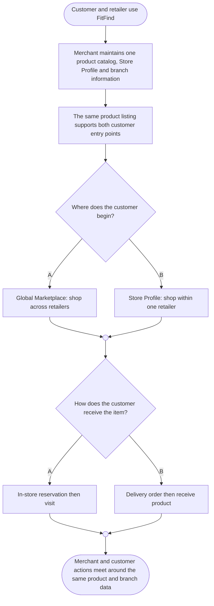

Shows how the shared catalog supports two customer entry points and two fulfillment paths.

### DG-02 Customer discovery and product selection

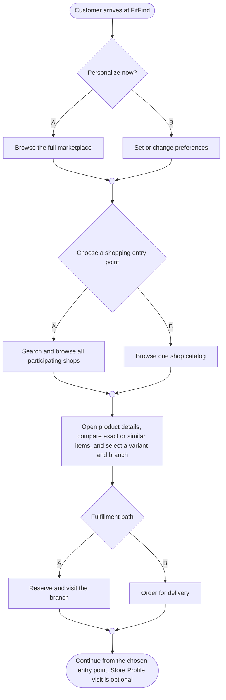

Shows optional personalization, two independent shopping entry points and the fulfillment choice.

### DG-03 Global Marketplace shopping path

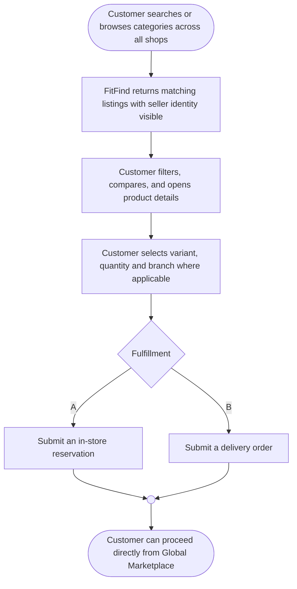

Shows discovery and fulfillment directly from marketplace results; a Store Profile visit is optional.

### DG-04 Store Profile shopping path

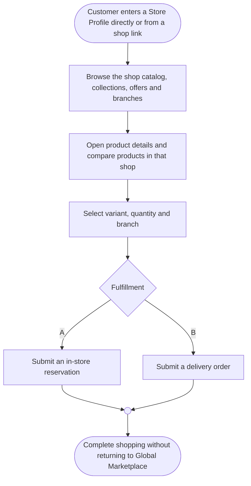

Shows that shopping can begin and finish within one shop profile.

### DG-05 In-store reservation lifecycle

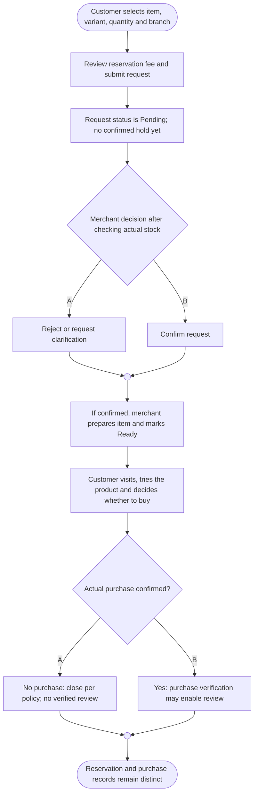

Shows Pending, merchant decision, preparation, in-person visit and separate purchase verification.

### DG-06 Delivery order journey

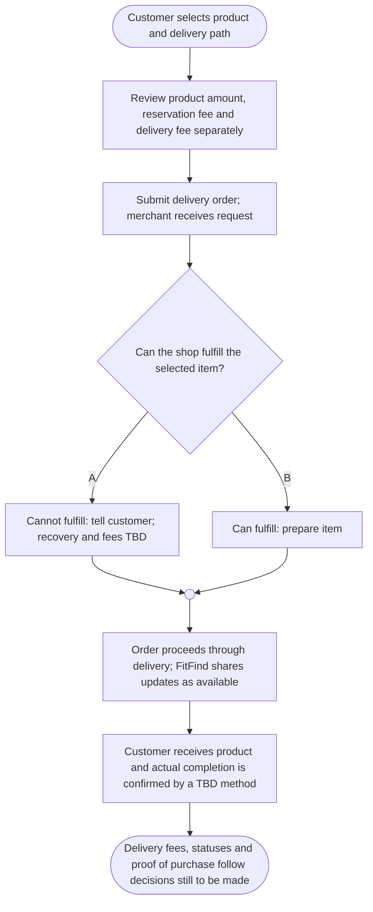

Separates delivery order review from in-store reservation and leaves delivery policy TBD.

### DG-07 Merchant free account and subscription journey

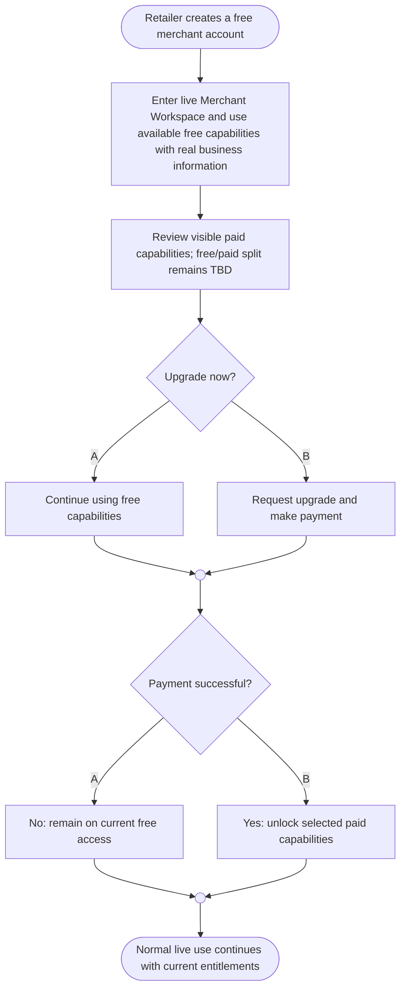

Shows live free access first, optional upgrade, and unlock only after successful payment.

### DG-08 Merchant business and Store Profile setup

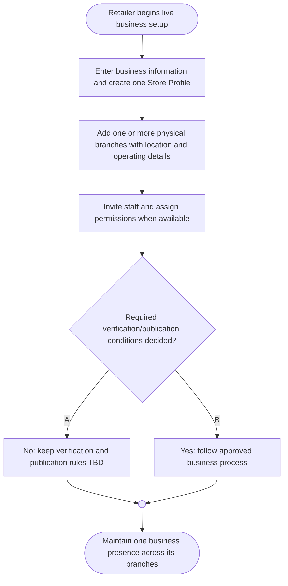

Shows business, one profile, branches and staff; verification/publication rules remain TBD.

### DG-09 Product creation and publication

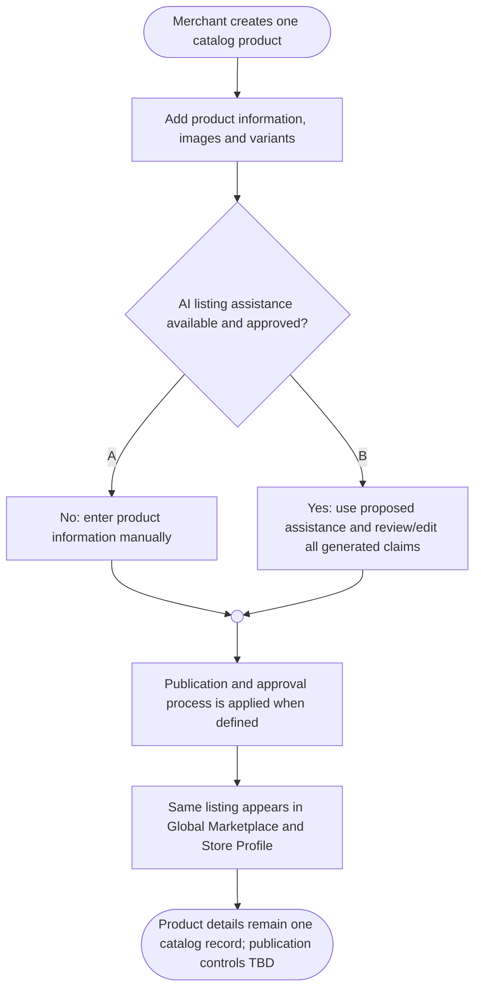

Shows one listing and flags the disputed AI listing-assistance branch as optional/proposed.

### DG-10 Branch inventory management

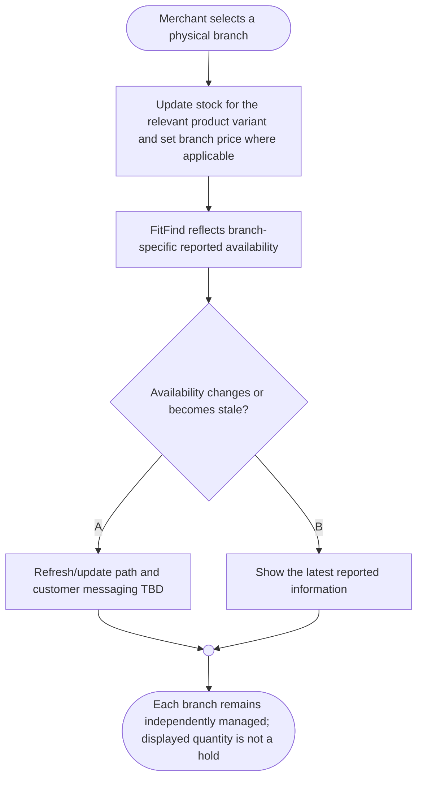

Shows independent branch updates and explicitly states displayed quantity is not a hold.

### DG-11 Merchant reservation management

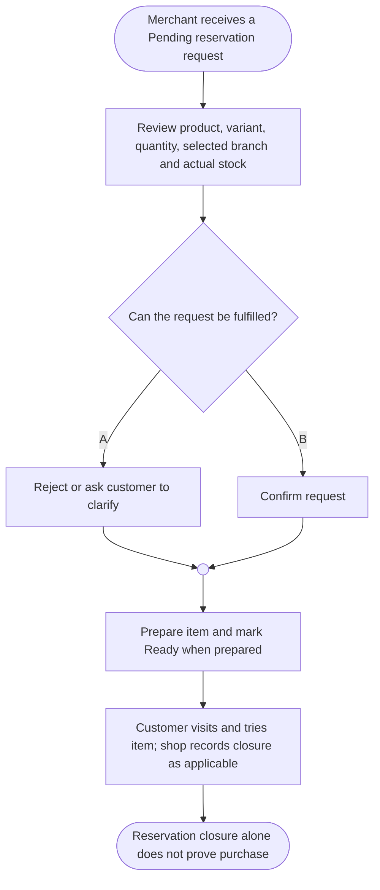

Shows merchant decision and preparation for reservation requests.

### DG-12 Customer support and return journey

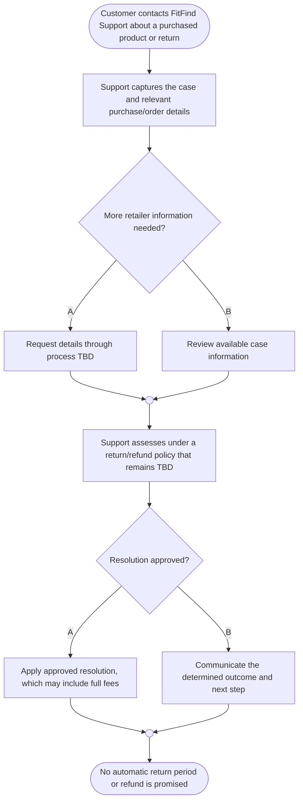

Shows support review without inventing return eligibility or refund rules.

### DG-13 Purchase verification and review eligibility

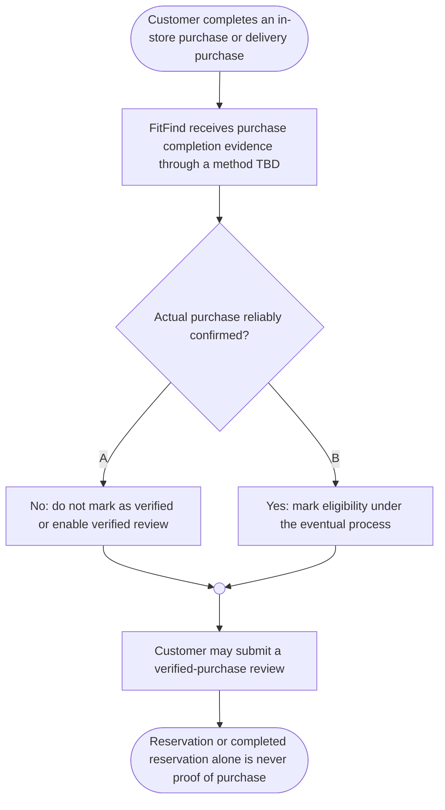

Shows actual purchase confirmation as a prerequisite for verified review eligibility.

## 4. Customer workflows

### `WF-CUS-001`  Arrive, browse and personalize

A customer may start exploring immediately or provide preferences that shape discovery without restricting access to the marketplace.

| Workflow field | Definition |
| --- | --- |
| Status | Agreed Direction |
| Primary Actor | Customer |
| Supporting Actors | FitFind |
| Trigger | Customer opens FitFind. |
| Preconditions | Marketplace is available; account requirements for browsing and saving remain TBD. |
| Source | PDF p.3, 1.1-1.2 |
| Diagram | DG-02 |

**Main Flow**

**Step 01 — Actor: Customer — Action / system response:** Browse now or select preference setup.
**Step 02 — Actor: Customer — Action / system response:** Optionally choose audience (Men, Women, Kids), style, colors, budget and favorite shops/brands.
**Step 03 — Actor: FitFind — Action / system response:** Applies available preferences to the feed while retaining access to all marketplace inventory.
**Step 04 — Actor: Customer — Action / system response:** Can later revise preferences.

| Alternative Flow | Behavior |
| --- | --- |
| `ALT-WF-CUS-001-01` | Skip preference setup |
| `ALT-WF-CUS-001-02` | browse full marketplace. |

| Exception / Failure Flow | Behavior |
| --- | --- |
| `EX-WF-CUS-001-01` | Preference service unavailable: continue general marketplace browsing. Invalid or incomplete preference values: preserve prior valid selections and show a clear prompt (exact handling TBD). |

- **Postconditions:** Customer reaches marketplace discovery with optional preference signals.
- **Related Business Rules:** `BR-002`, `BR-003`
- **Related Workflows:** `WF-CUS-002`, `WF-CUS-003`, `WF-CUS-007`
- **Open Decisions / Dependencies:** Account requirements; final preference options and budget bands; use and retention of preference data.

### `WF-CUS-002`  Browse and search the Global Marketplace

The customer discovers products across retailers in one shared shopping space and can continue directly to fulfillment.

| Workflow field | Definition |
| --- | --- |
| Status | Agreed Direction |
| Primary Actor | Customer |
| Supporting Actors | Participating merchants; FitFind |
| Trigger | Customer searches, chooses a category or opens marketplace discovery. |
| Preconditions | Participating product listings are available to FitFind. |
| Source | PDF p.2-3, product concept/1.4 |
| Diagram | DG-03 |

**Main Flow**

**Step 01 — Actor: Customer — Action / system response:** Browse home, category or search.
**Step 02 — Actor: Customer — Action / system response:** Enter a search term and apply available filters such as size, color, price or style.
**Step 03 — Actor: FitFind — Action / system response:** Returns matching listings from participating shops together.
**Step 04 — Actor: FitFind — Action / system response:** Keeps seller identity visible on listings or product details.
**Step 05 — Actor: Customer — Action / system response:** Opens a listing, compares results or proceeds to product detail and fulfillment.

| Alternative Flow | Behavior |
| --- | --- |
| `ALT-WF-CUS-002-01` | Search a broad term |
| `ALT-WF-CUS-002-02` | narrow with filters |
| `ALT-WF-CUS-002-03` | remove filters |
| `ALT-WF-CUS-002-04` | open seller profile optionally. |

| Exception / Failure Flow | Behavior |
| --- | --- |
| `EX-WF-CUS-002-01` | No results or no exact result: show that fact, offer query/category alternatives and similar results without labeling them exact. Search service unavailable: communicate issue and preserve retry path. |

- **Postconditions:** Customer can select a listing and proceed without first opening a Store Profile.
- **Related Business Rules:** `BR-002`, `BR-003`, `BR-005`
- **Related Workflows:** `WF-CUS-004`, `WF-CUS-005`, `WF-CUS-009`, `WF-CUS-011`, `WF-SYS-001`
- **Open Decisions / Dependencies:** Search ranking, filter set, exact-match rules, launch scope, account access.

### `WF-CUS-003`  Shop directly from a Store Profile

The customer can enter one retailer’s branded profile and complete discovery and shopping there.

| Workflow field | Definition |
| --- | --- |
| Status | Agreed Direction |
| Primary Actor | Customer |
| Supporting Actors | Merchant; FitFind |
| Trigger | Customer opens a Store Profile from a link, followed shop or direct navigation. |
| Preconditions | Business has a Store Profile with customer-visible content. |
| Source | PDF p.2-3, Store Profile/1.6 |
| Diagram | DG-04 |

**Main Flow**

**Step 01 — Actor: FitFind — Action / system response:** Shows business identity, one shop catalog, branches, collections, offers and announcements.
**Step 02 — Actor: Customer — Action / system response:** Browses products and opens details.
**Step 03 — Actor: Customer — Action / system response:** Selects a variant and branch, then chooses reservation or delivery.
**Step 04 — Actor: FitFind — Action / system response:** Uses the same product listing and branch information used by Global Marketplace.

| Alternative Flow | Behavior |
| --- | --- |
| `ALT-WF-CUS-003-01` | Follow the shop |
| `ALT-WF-CUS-003-02` | browse collections |
| `ALT-WF-CUS-003-03` | compare products within the shop |
| `ALT-WF-CUS-003-04` | return to Global Marketplace if desired. |

| Exception / Failure Flow | Behavior |
| --- | --- |
| `EX-WF-CUS-003-01` | Profile or item is unavailable: communicate current state and offer another discovery route. |

- **Postconditions:** Customer can complete the shopping journey without returning to the Global Marketplace.
- **Related Business Rules:** `BR-002`, `BR-003`, `BR-004`, `BR-005`
- **Related Workflows:** `WF-CUS-005`, `WF-CUS-009`, `WF-CUS-011`, `WF-MER-003`, `WF-SYS-001`
- **Open Decisions / Dependencies:** Storefront templates/customization; profile publication controls.

### `WF-CUS-004`  Search visually

The customer supplies an image to discover visually similar marketplace listings.

| Workflow field | Definition |
| --- | --- |
| Status | Proposed Feature |
| Primary Actor | Customer |
| Supporting Actors | FitFind; image service dependency TBD |
| Trigger | Customer selects visual search. |
| Preconditions | Customer supplies an image; image privacy and device/camera conditions are TBD. |
| Source | PDF p.3, 1.5 |
| Diagram | No dedicated diagram; covered by related process diagrams. |

**Main Flow**

**Step 01 — Actor: Customer — Action / system response:** Upload or capture an image where supported.
**Step 02 — Actor: FitFind — Action / system response:** Finds visually similar products across the marketplace.
**Step 03 — Actor: FitFind — Action / system response:** Shows seller identity and relevant product/branch information with results.
**Step 04 — Actor: Customer — Action / system response:** Opens, compares or saves a result.

| Alternative Flow | Behavior |
| --- | --- |
| `ALT-WF-CUS-004-01` | Use image upload instead of camera |
| `ALT-WF-CUS-004-02` | refine discovery through text or filters. |

| Exception / Failure Flow | Behavior |
| --- | --- |
| `EX-WF-CUS-004-01` | No visually similar result: explain that no suitable match was found and offer ordinary search. Image cannot be processed: explain and allow retry or text search. |

- **Postconditions:** Customer can continue product exploration; similarity is not represented as exact identity.
- **Related Business Rules:** `BR-002`, `BR-005`
- **Related Workflows:** `WF-CUS-002`, `WF-CUS-005`
- **Open Decisions / Dependencies:** Image handling, privacy, retention, accuracy, device support, launch priority.

### `WF-CUS-005`  Review product details, compare, select variant and branch

The customer evaluates the product and the specific branch/variant before choosing a fulfillment path.

| Workflow field | Definition |
| --- | --- |
| Status | Agreed Direction |
| Primary Actor | Customer |
| Supporting Actors | Merchant; FitFind |
| Trigger | Customer opens a product listing. |
| Preconditions | Product, variant and branch information may be available; freshness may vary. |
| Source | PDF p.4, 1.7-1.8 |
| Diagram | DG-02 |

**Main Flow**

**Step 01 — Actor: FitFind — Action / system response:** Shows images, description, options, seller identity, prices and reported availability.
**Step 02 — Actor: Customer — Action / system response:** Compares exact matches or similar alternatives.
**Step 03 — Actor: Customer — Action / system response:** Selects size, color and other applicable variant details.
**Step 04 — Actor: Customer — Action / system response:** Selects branch and quantity where applicable.
**Step 05 — Actor: FitFind — Action / system response:** Shows branch-specific reported stock and price.

| Alternative Flow | Behavior |
| --- | --- |
| `ALT-WF-CUS-005-01` | Choose another variant/branch |
| `ALT-WF-CUS-005-02` | open seller Store Profile optionally |
| `ALT-WF-CUS-005-03` | ask a product question. |

| Exception / Failure Flow | Behavior |
| --- | --- |
| `EX-WF-CUS-005-01` | Variant unavailable/out of stock or stock changed: show unavailable/currently uncertain status and recovery alternatives. Never treat displayed quantity as a hold. |

- **Postconditions:** Customer has a selected listing, variant and relevant branch to use in reservation or delivery.
- **Related Business Rules:** `BR-005`, `BR-007`, `BR-008`, `BR-009`
- **Related Workflows:** `WF-CUS-008`, `WF-CUS-009`, `WF-CUS-011`, `WF-MER-008`
- **Open Decisions / Dependencies:** Comparison fields and exact-match behavior; inventory refresh; branch price model.

### `WF-CUS-006`  Use virtual try-on and build an outfit

The customer can explore an AI-assisted visual preview and combine items from shops. These are proposed capabilities.

| Workflow field | Definition |
| --- | --- |
| Status | Proposed Feature |
| Primary Actor | Customer |
| Supporting Actors | FitFind; image/AI service dependency TBD; participating shops |
| Trigger | Customer opens virtual try-on or Outfit Builder. |
| Preconditions | Relevant listing images and required customer inputs are available; image handling is undecided. |
| Source | PDF p.4, 1.9 |
| Diagram | No dedicated diagram; covered by related process diagrams. |

**Main Flow**

**Step 01 — Actor: Customer — Action / system response:** Selects one or more clothing, shoe or accessory listings.
**Step 02 — Actor: FitFind — Action / system response:** Produces an AI-assisted preview where try-on is offered.
**Step 03 — Actor: FitFind — Action / system response:** Keeps each outfit item linked to its own listing, seller, branch availability and price.
**Step 04 — Actor: Customer — Action / system response:** Saves the outfit or opens each item separately.

| Alternative Flow | Behavior |
| --- | --- |
| `ALT-WF-CUS-006-01` | Build outfit from multiple shops |
| `ALT-WF-CUS-006-02` | remove or replace an item |
| `ALT-WF-CUS-006-03` | save preview if supported. |

| Exception / Failure Flow | Behavior |
| --- | --- |
| `EX-WF-CUS-006-01` | Preview unavailable or low confidence: communicate limitation and retain ordinary product details. Do not imply fit or availability certainty. |

- **Postconditions:** Customer has inspiration and separate product choices, not a single multi-shop order.
- **Related Business Rules:** `BR-005`
- **Related Workflows:** `WF-CUS-005`, `WF-CUS-007`
- **Open Decisions / Dependencies:** Try-on accuracy, image/privacy rules, outfit save behavior and phase.

### `WF-CUS-007`  Save products, follow shops and watch variants

The customer keeps items accessible and may receive updates when followed shops or watched products change.

| Workflow field | Definition |
| --- | --- |
| Status | Proposed Feature |
| Primary Actor | Customer |
| Supporting Actors | FitFind; merchants |
| Trigger | Customer saves an item, follows a shop or watches a product/variant. |
| Preconditions | Sign-in requirements and notification preferences are TBD. |
| Source | PDF p.4, 1.10 |
| Diagram | No dedicated diagram; covered by related process diagrams. |

**Main Flow**

**Step 01 — Actor: Customer — Action / system response:** Save to wishlist or revisit recently viewed products.
**Step 02 — Actor: Customer — Action / system response:** Follow/unfollow a shop or watch/unwatch a product/variant.
**Step 03 — Actor: FitFind — Action / system response:** Retains the customer’s selection and associates it with the correct listing.
**Step 04 — Actor: FitFind — Action / system response:** May send relevant restock, price, collection or announcement updates according to approved notification rules.

| Alternative Flow | Behavior |
| --- | --- |
| `ALT-WF-CUS-007-01` | Remove saved item |
| `ALT-WF-CUS-007-02` | change notification preferences |
| `ALT-WF-CUS-007-03` | open a followed shop or watched item. |

| Exception / Failure Flow | Behavior |
| --- | --- |
| `EX-WF-CUS-007-01` | Item removed or no longer available: retain clear status and do not imply current stock. Alert delivery failure: expose current information when customer returns. |

- **Postconditions:** Customer can revisit saved choices and relevant updates.
- **Related Business Rules:** `BR-005`, `BR-007`
- **Related Workflows:** `WF-CUS-002`, `WF-CUS-003`, `WF-CUS-005`, `WF-MER-009`, `WF-MER-015`
- **Open Decisions / Dependencies:** Sign-in, alert types/channels, preference controls, event freshness and privacy.

### `WF-CUS-008`  Ask a product question

A customer asks about product-specific details when the listing does not answer the question.

| Workflow field | Definition |
| --- | --- |
| Status | Proposed Feature |
| Primary Actor | Customer |
| Supporting Actors | Shop staff; FitFind; controlled AI/hybrid process may be proposed |
| Trigger | Customer starts a question from a product or shop context. |
| Preconditions | Relevant product and shop context can be attached. |
| Source | PDF p.4, 1.11 |
| Diagram | No dedicated diagram; covered by related process diagrams. |

**Main Flow**

**Step 01 — Actor: Customer — Action / system response:** Enters a question about fit, fabric, size, availability or another product detail.
**Step 02 — Actor: FitFind — Action / system response:** Routes it to the shop or authorized response process.
**Step 03 — Actor: Merchant/staff — Action / system response:** Responds manually or reviews an AI-assisted response where available.
**Step 04 — Actor: FitFind — Action / system response:** Shows the answer to the customer.

| Alternative Flow | Behavior |
| --- | --- |
| `ALT-WF-CUS-008-01` | AI-assisted draft can be used if enabled, reviewed or controlled according to approved policy. |

| Exception / Failure Flow | Behavior |
| --- | --- |
| `EX-WF-CUS-008-01` | If uncertain or current stock cannot be established, response is escalated to staff |
| `EX-WF-CUS-008-02` | AI must not invent product facts or stock. |

- **Postconditions:** Customer receives a product-specific answer or clear indication that more information is needed.
- **Related Business Rules:** `BR-007`, `BR-009`
- **Related Workflows:** `WF-MER-013`, `WF-MER-015`
- **Open Decisions / Dependencies:** AI response scope, escalation and response-time expectations.

### `WF-CUS-009`  Request an in-store reservation

The customer requests a selected product for a chosen branch, then waits for the merchant’s decision before visiting.

| Workflow field | Definition |
| --- | --- |
| Status | Agreed Direction |
| Primary Actor | Customer |
| Supporting Actors | Merchant/branch staff; FitFind; payment dependency for reservation fee |
| Trigger | Customer chooses in-store reservation after selecting listing, variant, quantity and branch. |
| Preconditions | A suitable listing and branch are shown; fee amount and payment flow are TBD. |
| Source | PDF p.5, 1.12 Path A |
| Diagram | DG-05 |

**Main Flow**

**Step 01 — Actor: Customer — Action / system response:** Reviews product amount and applicable reservation fee as distinct amounts.
**Step 02 — Actor: Customer — Action / system response:** Submits reservation request.
**Step 03 — Actor: FitFind — Action / system response:** Records request as Pending and routes it to the selected shop/branch.
**Step 04 — Actor: Merchant — Action / system response:** Checks actual stock and confirms, rejects or requests clarification.
**Step 05 — Actor: FitFind — Action / system response:** Communicates merchant decision.
**Step 06 — Actor: Customer — Action / system response:** After confirmation/Ready, visits and tries the item; product purchase occurs at shop only if customer chooses to buy.

| Alternative Flow | Behavior |
| --- | --- |
| `ALT-WF-CUS-009-01` | If merchant asks clarification, customer responds |
| `ALT-WF-CUS-009-02` | after rejection, try another branch, variant or shop |
| `ALT-WF-CUS-009-03` | after confirmation, visit before any stated hold deadline. |

| Exception / Failure Flow | Behavior |
| --- | --- |
| `EX-WF-CUS-009-01` | Submission failure: do not show request as submitted. Pending too long: retain Pending and offer available contact/recovery |
| `EX-WF-CUS-009-02` | duration TBD. Reservation fee handling on rejection/cancellation remains TBD. |

- **Postconditions:** A reservation request and its outcome exist; an actual product purchase remains a separate event.
- **Related Business Rules:** `BR-007`, `BR-009`, `BR-010`, `BR-011`, `BR-012`, `BR-014`, `BR-015`, `BR-017`
- **Related Workflows:** `WF-CUS-010`, `WF-MER-010`, `WF-MER-011`, `WF-SYS-002`
- **Open Decisions / Dependencies:** Reservation fee amount/collection/refunds; pending/hold durations; multi-item rules; cancellation/expiry authority; payment mechanics.

### `WF-CUS-010`  Follow reservation status and recover exceptions

The customer follows the shop’s decision and the later reservation outcome.

| Workflow field | Definition |
| --- | --- |
| Status | Agreed Direction |
| Primary Actor | Customer |
| Supporting Actors | Merchant; FitFind |
| Trigger | Customer views a submitted reservation. |
| Preconditions | Reservation exists. |
| Source | PDF p.5-6, 1.13 |
| Diagram | DG-05 |

**Main Flow**

**Step 01 — Actor: FitFind — Action / system response:** Shows status and available history.
**Step 02 — Actor: Customer — Action / system response:** Reviews status and any merchant message.
**Step 03 — Actor: FitFind — Action / system response:** Treats Pending as undecided, Confirmed as accepted, Ready as prepared, Rejected as unfulfilled, Expired/Cancelled as inactive, and Completed as closed.
**Step 04 — Actor: Customer — Action / system response:** Takes the next action shown for the status.

| Alternative Flow | Behavior |
| --- | --- |
| `ALT-WF-CUS-010-01` | For Pending, wait or explore alternatives |
| `ALT-WF-CUS-010-02` | for Rejected, choose another branch/product |
| `ALT-WF-CUS-010-03` | for Ready, visit |
| `ALT-WF-CUS-010-04` | for Cancelled/Expired, check current stock and submit a new request if appropriate. |

| Exception / Failure Flow | Behavior |
| --- | --- |
| `EX-WF-CUS-010-01` | Pending too long, rejection, expiry, cancellation, or status update failure: explain current state |
| `EX-WF-CUS-010-02` | no status is converted into purchase proof. |

- **Postconditions:** Customer knows the request outcome and possible next step.
- **Related Business Rules:** `BR-009`, `BR-010`, `BR-011`, `BR-012`
- **Related Workflows:** `WF-CUS-009`, `WF-MER-010`, `WF-MER-011`, `WF-SYS-002`
- **Open Decisions / Dependencies:** Pending SLA, hold period, cancellation/expiry rules and status notification channel.

### `WF-CUS-011`  Place a delivery order

The customer chooses delivery as a separate fulfillment path available from either shopping entry point.

| Workflow field | Definition |
| --- | --- |
| Status | Agreed Direction |
| Primary Actor | Customer |
| Supporting Actors | Merchant; FitFind; delivery and payment dependencies TBD |
| Trigger | Customer chooses delivery after selecting product, variant and quantity. |
| Preconditions | Product/variant is listed; branch selection applicability, coverage and payment rules remain TBD. |
| Source | PDF p.5, 1.12 Path B |
| Diagram | DG-06 |

**Main Flow**

**Step 01 — Actor: Customer — Action / system response:** Selects variant, quantity and relevant branch where applicable.
**Step 02 — Actor: Customer — Action / system response:** Chooses delivery.
**Step 03 — Actor: FitFind — Action / system response:** Presents product amount, reservation fee and delivery fee separately.
**Step 04 — Actor: Customer — Action / system response:** Reviews and submits the order.
**Step 05 — Actor: FitFind — Action / system response:** Routes order to shop for actual availability check and preparation.

| Alternative Flow | Behavior |
| --- | --- |
| `ALT-WF-CUS-011-01` | If branch selection is not needed, use the eventual delivery selection policy |
| `ALT-WF-CUS-011-02` | customer may return to in-store path before submission. |

| Exception / Failure Flow | Behavior |
| --- | --- |
| `EX-WF-CUS-011-01` | Payment or submission failure: show order not submitted. Shop cannot fulfill: tell customer and expose recovery |
| `EX-WF-CUS-011-02` | fee/refund treatment TBD. |

- **Postconditions:** A delivery order is submitted and can be followed; no specific provider/status model is assumed.
- **Related Business Rules:** `BR-005`, `BR-007`, `BR-014`, `BR-015`, `BR-016`, `BR-017`
- **Related Workflows:** `WF-CUS-012`, `WF-MER-012`, `WF-SYS-002`
- **Open Decisions / Dependencies:** Coverage, provider, branch rule, payment timing, fee calculation/collection, statuses, failure/refusal/refund rules.

### `WF-CUS-012`  Follow delivery order updates

The customer follows the delivery order through available updates without assuming an unapproved status lifecycle.

| Workflow field | Definition |
| --- | --- |
| Status | Agreed Direction |
| Primary Actor | Customer |
| Supporting Actors | Merchant; delivery provider TBD; FitFind |
| Trigger | Customer views a submitted delivery order. |
| Preconditions | Delivery order exists and shop has started processing. |
| Source | PDF p.5-6, delivery/status decisions |
| Diagram | DG-06 |

**Main Flow**

**Step 01 — Actor: FitFind — Action / system response:** Displays updates made available by the shop or eventual delivery process.
**Step 02 — Actor: Customer — Action / system response:** Reviews order and delivery information.
**Step 03 — Actor: Merchant/provider — Action / system response:** Updates progress under a process still to be defined.
**Step 04 — Actor: Customer — Action / system response:** Receives the product; actual purchase completion is confirmed through a TBD method.

| Alternative Flow | Behavior |
| --- | --- |
| `ALT-WF-CUS-012-01` | Customer contacts support for an update if available |
| `ALT-WF-CUS-012-02` | exact channels and statuses TBD. |

| Exception / Failure Flow | Behavior |
| --- | --- |
| `EX-WF-CUS-012-01` | Order cannot be fulfilled, delivery fails, order is cancelled or refused: communicate known state and route to the eventual support/refund process. |

- **Postconditions:** Customer has current available information; no unsupported status or completion promise is made.
- **Related Business Rules:** `BR-012`, `BR-013`, `BR-016`
- **Related Workflows:** `WF-CUS-011`, `WF-MER-012`, `WF-SYS-002`, `WF-SYS-003`
- **Open Decisions / Dependencies:** Delivery statuses, coverage, failed/refused order handling and purchase evidence.

### `WF-CUS-013`  Request a return and contact FitFind Support

A customer may contact Support after purchase; the proposed case review is not a finalized return/refund policy.

| Workflow field | Definition |
| --- | --- |
| Status | Proposed Feature |
| Primary Actor | Customer |
| Supporting Actors | FitFind Support; merchant may provide information |
| Trigger | Customer wants to return a purchased product or ask for a resolution. |
| Preconditions | Customer has a purchase/order context; eligibility and timing rules are TBD. |
| Source | PDF p.6, 1.14 |
| Diagram | DG-12 |

**Main Flow**

**Step 01 — Actor: Customer — Action / system response:** Opens a support request and explains the reason.
**Step 02 — Actor: FitFind Support — Action / system response:** Reviews case details and may obtain relevant merchant information.
**Step 03 — Actor: Support — Action / system response:** Determines the resolution according to policy once established.
**Step 04 — Actor: FitFind — Action / system response:** Communicates outcome and any approved fee treatment.

| Alternative Flow | Behavior |
| --- | --- |
| `ALT-WF-CUS-013-01` | Customer may add requested purchase/order information or follow up under support instructions. |

| Exception / Failure Flow | Behavior |
| --- | --- |
| `EX-WF-CUS-013-01` | Missing purchase evidence or policy details: keep case unresolved/under review |
| `EX-WF-CUS-013-02` | do not promise a return or automatic refund. |

- **Postconditions:** Support outcome is recorded and communicated under an approved policy.
- **Related Business Rules:** `BR-017`, `BR-018`
- **Related Workflows:** `WF-MER-014`, `WF-SYS-003`
- **Open Decisions / Dependencies:** Return period, eligibility, responsible party, fee refunds, workflow ownership and escalation.

### `WF-CUS-014`  Submit a verified-purchase review

A customer may submit a review only after actual in-store or delivery purchase is confirmed.

| Workflow field | Definition |
| --- | --- |
| Status | Agreed Direction |
| Primary Actor | Customer |
| Supporting Actors | FitFind; purchase-confirmation source TBD |
| Trigger | Customer attempts to review a product after purchase. |
| Preconditions | Actual purchase completion has been reliably confirmed. |
| Source | PDF p.6, 1.15 |
| Diagram | DG-13 |

**Main Flow**

**Step 01 — Actor: FitFind — Action / system response:** Checks purchase confirmation status.
**Step 02 — Actor: FitFind — Action / system response:** Enables verified-purchase review eligibility only after confirmation.
**Step 03 — Actor: Customer — Action / system response:** Submits review.
**Step 04 — Actor: FitFind — Action / system response:** Associates review with the product and verified-purchase state under policy.

| Alternative Flow | Behavior |
| --- | --- |
| `ALT-WF-CUS-014-01` | If purchase is not confirmed, customer can wait or contact support |
| `ALT-WF-CUS-014-02` | reservation alone does not qualify. |

| Exception / Failure Flow | Behavior |
| --- | --- |
| `EX-WF-CUS-014-01` | Verification method unavailable or disputed: do not label the review verified until resolved. |

- **Postconditions:** Eligible review is submitted with the correct verification state.
- **Related Business Rules:** `BR-012`, `BR-013`
- **Related Workflows:** `WF-CUS-009`, `WF-CUS-011`, `WF-SYS-002`
- **Open Decisions / Dependencies:** Verification evidence for in-store and delivery purchases; review moderation and publication rules.

### `WF-CUS-015`  Recover from search and availability problems

FitFind explains missing results and changing availability and offers realistic discovery options.

| Workflow field | Definition |
| --- | --- |
| Status | Agreed Direction |
| Primary Actor | Customer |
| Supporting Actors | FitFind; merchants |
| Trigger | No exact result or selected item/variant is unavailable or stock changed. |
| Preconditions | Customer is searching or has opened a product. |
| Source | PDF p.3-4, 1.4-1.8 |
| Diagram | No dedicated diagram; covered by related process diagrams. |

**Main Flow**

**Step 01 — Actor: FitFind — Action / system response:** States whether no exact match, unavailable variant, out of stock or changed availability applies.
**Step 02 — Actor: FitFind — Action / system response:** Distinguishes similar products from exact matches.
**Step 03 — Actor: Customer — Action / system response:** Changes search, filters or variant; checks another branch/shop; asks a question; or watches item for updates.

| Alternative Flow | Behavior |
| --- | --- |
| `ALT-WF-CUS-015-01` | Use visual search |
| `ALT-WF-CUS-015-02` | open alternatives |
| `ALT-WF-CUS-015-03` | follow the shop/product. |

| Exception / Failure Flow | Behavior |
| --- | --- |
| `EX-WF-CUS-015-01` | Availability data stale: state that reported stock can change and is not held. No alternatives: explain and allow revised search. |

- **Postconditions:** Customer has a valid next discovery path without a false availability promise.
- **Related Business Rules:** `BR-005`, `BR-007`, `BR-009`
- **Related Workflows:** `WF-CUS-002`, `WF-CUS-004`, `WF-CUS-005`, `WF-CUS-007`, `WF-CUS-008`
- **Open Decisions / Dependencies:** Exact match rules, stale-data messaging and update frequency.

### `WF-CUS-016`  Recover from reservation exceptions

Customer follows explicit outcomes for requests that remain Pending, are rejected, expire or are cancelled.

| Workflow field | Definition |
| --- | --- |
| Status | Agreed Direction |
| Primary Actor | Customer |
| Supporting Actors | Merchant; FitFind |
| Trigger | Reservation status does not advance as expected or becomes inactive. |
| Preconditions | Reservation exists. |
| Source | PDF p.5-6, 1.13 and recovery paths |
| Diagram | No dedicated diagram; covered by related process diagrams. |

**Main Flow**

**Step 01 — Actor: FitFind — Action / system response:** Shows the actual status and available explanation.
**Step 02 — Actor: Customer — Action / system response:** For Pending, waits or pursues alternatives; for Rejected, tries another option; for Expired/Cancelled, checks current availability before a new request.
**Step 03 — Actor: FitFind — Action / system response:** Keeps request status separate from purchase confirmation.

| Alternative Flow | Behavior |
| --- | --- |
| `ALT-WF-CUS-016-01` | Customer contacts merchant/support if that route exists |
| `ALT-WF-CUS-016-02` | exact contact channels TBD. |

| Exception / Failure Flow | Behavior |
| --- | --- |
| `EX-WF-CUS-016-01` | Long-pending decision, fee/refund consequence or disputed cancellation: route according to future policy |
| `EX-WF-CUS-016-02` | do not assume automatic resolution. |

- **Postconditions:** Customer receives accurate state and possible next action.
- **Related Business Rules:** `BR-009`, `BR-010`, `BR-011`, `BR-012`
- **Related Workflows:** `WF-CUS-009`, `WF-CUS-010`, `WF-MER-010`
- **Open Decisions / Dependencies:** Response and hold timing; cancellation actor; reservation-fee consequences.

### `WF-CUS-017`  Recover from delivery exceptions

Customer is informed when a shop cannot fulfill, or a delivery is cancelled, failed or refused.

| Workflow field | Definition |
| --- | --- |
| Status | Agreed Direction |
| Primary Actor | Customer |
| Supporting Actors | Merchant; delivery provider TBD; FitFind Support |
| Trigger | Order cannot proceed or has an exception. |
| Preconditions | Delivery order exists. |
| Source | PDF p.6, recovery paths; p.13 delivery decisions |
| Diagram | No dedicated diagram; covered by related process diagrams. |

**Main Flow**

**Step 01 — Actor: FitFind — Action / system response:** Communicates the known issue without inventing delivery statuses.
**Step 02 — Actor: Customer — Action / system response:** Reviews options and contacts Support or shop as available.
**Step 03 — Actor: FitFind — Action / system response:** Applies fee/order resolution once policy is decided.

| Alternative Flow | Behavior |
| --- | --- |
| `ALT-WF-CUS-017-01` | Customer may choose an alternative product or in-store path if available. |

| Exception / Failure Flow | Behavior |
| --- | --- |
| `EX-WF-CUS-017-01` | Failed delivery, refusal, cancellation, or fee dispute: keep final handling TBD |
| `EX-WF-CUS-017-02` | no fee refund is promised. |

- **Postconditions:** Customer can see the available next step and case status.
- **Related Business Rules:** `BR-016`, `BR-017`, `BR-018`
- **Related Workflows:** `WF-CUS-011`, `WF-CUS-012`, `WF-CUS-013`, `WF-MER-012`
- **Open Decisions / Dependencies:** Delivery exception statuses, redelivery/cancellation, responsibility and refund rules.

## 5. Merchant workflows

### `WF-MER-001`  Create a free merchant account and begin live use

Retailer begins with a free live account, using real business information and available free features.

| Workflow field | Definition |
| --- | --- |
| Status | Agreed Direction |
| Primary Actor | Retailer / owner |
| Supporting Actors | FitFind |
| Trigger | Retailer decides to use FitFind. |
| Preconditions | Account, verification and publication details are not yet established. |
| Source | PDF p.7, 2.1 and p.12 agreed directions |
| Diagram | DG-07 |

**Main Flow**

**Step 01 — Actor: Retailer — Action / system response:** Creates a merchant account.
**Step 02 — Actor: FitFind — Action / system response:** Opens the live Merchant Workspace with available free capabilities.
**Step 03 — Actor: Retailer — Action / system response:** Uses real shop information in normal work.
**Step 04 — Actor: FitFind — Action / system response:** Identifies paid capabilities, if presented, without assuming the free/paid split.

| Alternative Flow | Behavior |
| --- | --- |
| `ALT-WF-MER-001-01` | Retailer may proceed to business setup first or explore free capabilities that do not require completed setup. |

| Exception / Failure Flow | Behavior |
| --- | --- |
| `EX-WF-MER-001-01` | Account creation or verification cannot complete: communicate what is required |
| `EX-WF-MER-001-02` | exact criteria TBD. |

- **Postconditions:** Retailer has a live free account; no separate mock-data demo is required.
- **Related Business Rules:** `BR-019`
- **Related Workflows:** `WF-MER-002`, `WF-MER-003`
- **Open Decisions / Dependencies:** Account fields, verification timing, free capability list, initial publication rules.

### `WF-MER-002`  Upgrade and unlock paid capabilities

Retailer may continue free or choose an upgrade; successful payment unlocks paid capabilities included in the chosen offer.

| Workflow field | Definition |
| --- | --- |
| Status | Agreed Direction |
| Primary Actor | Retailer / owner |
| Supporting Actors | FitFind; payment service provider TBD |
| Trigger | Retailer selects an upgrade path. |
| Preconditions | Live free merchant account exists; plans and prices are TBD. |
| Source | PDF p.7, 2.4-2.6; p.13 free access decisions |
| Diagram | DG-07 |

**Main Flow**

**Step 01 — Actor: FitFind — Action / system response:** Shows plan and paid capability details once decided.
**Step 02 — Actor: Retailer — Action / system response:** Selects upgrade and proceeds to payment.
**Step 03 — Actor: Payment dependency — Action / system response:** Confirms success/failure.
**Step 04 — Actor: FitFind — Action / system response:** On success, unlocks paid capabilities included in selected plan.
**Step 05 — Actor: Retailer — Action / system response:** Continues in live workspace.

| Alternative Flow | Behavior |
| --- | --- |
| `ALT-WF-MER-002-01` | Retailer may decline and keep free access. Payment failure leaves paid access locked. |

| Exception / Failure Flow | Behavior |
| --- | --- |
| `EX-WF-MER-002-01` | Payment result uncertain: do not unlock paid features until success is confirmed |
| `EX-WF-MER-002-02` | recovery flow TBD. |

- **Postconditions:** Account entitlement matches confirmed payment outcome.
- **Related Business Rules:** `BR-019`
- **Related Workflows:** `WF-MER-001`, `WF-MER-014`
- **Open Decisions / Dependencies:** Plans, paid/free feature matrix, prices, recurring billing, cancellation, payment failure/refund.

### `WF-MER-003`  Set up the business and Store Profile

Owner creates the business presence and one Store Profile for customers.

| Workflow field | Definition |
| --- | --- |
| Status | Agreed Direction |
| Primary Actor | Business owner |
| Supporting Actors | FitFind; verification/review team not established |
| Trigger | Owner begins live business setup. |
| Preconditions | Live merchant account exists. |
| Source | PDF p.8, 2.7 |
| Diagram | DG-08 |

**Main Flow**

**Step 01 — Actor: Owner — Action / system response:** Enters business identity and contact information.
**Step 02 — Actor: Owner — Action / system response:** Creates and brands one Store Profile.
**Step 03 — Actor: FitFind — Action / system response:** Associates the profile with the business.
**Step 04 — Actor: Owner — Action / system response:** Reviews customer-facing details and submits/updates them as publication rules allow.

| Alternative Flow | Behavior |
| --- | --- |
| `ALT-WF-MER-003-01` | Update profile later |
| `ALT-WF-MER-003-02` | hide or change details as capabilities permit. |

| Exception / Failure Flow | Behavior |
| --- | --- |
| `EX-WF-MER-003-01` | Incomplete/invalid information or verification pending: show required next action |
| `EX-WF-MER-003-02` | criteria/timing TBD. |

- **Postconditions:** One business Store Profile is available for customer experience subject to publication decisions.
- **Related Business Rules:** `BR-001`, `BR-004`, `BR-005`
- **Related Workflows:** `WF-MER-001`, `WF-MER-004`, `WF-MER-006`, `WF-SYS-001`
- **Open Decisions / Dependencies:** Verification, profile templates/customization, publication approvals and visibility.

### `WF-MER-004`  Add and update physical branches

Owner keeps branch locations and operational details current under one business.

| Workflow field | Definition |
| --- | --- |
| Status | Agreed Direction |
| Primary Actor | Owner; authorized staff if permitted |
| Supporting Actors | FitFind |
| Trigger | Business adds or changes a physical location. |
| Preconditions | Business and Store Profile exist. |
| Source | PDF p.8, 2.8 |
| Diagram | DG-08 |

**Main Flow**

**Step 01 — Actor: Owner/staff — Action / system response:** Enter branch location, address, hours, contact details and status.
**Step 02 — Actor: FitFind — Action / system response:** Associates branch with business and exposes approved information.
**Step 03 — Actor: Owner/staff — Action / system response:** Updates details when they change.

| Alternative Flow | Behavior |
| --- | --- |
| `ALT-WF-MER-004-01` | Add multiple branches |
| `ALT-WF-MER-004-02` | change operating information |
| `ALT-WF-MER-004-03` | deactivate branch if allowed. |

| Exception / Failure Flow | Behavior |
| --- | --- |
| `EX-WF-MER-004-01` | Invalid/incomplete address or update failure: show error and retain previously valid branch information. |

- **Postconditions:** Branch information is available for customer location and availability choices.
- **Related Business Rules:** `BR-004`, `BR-006`, `BR-007`
- **Related Workflows:** `WF-CUS-005`, `WF-MER-008`, `WF-SYS-001`
- **Open Decisions / Dependencies:** Branch verification, location formats, deactivation and staff permissions.

### `WF-MER-005`  Invite staff and assign permissions

Owner invites employees and gives access according to roles that remain to be defined.

| Workflow field | Definition |
| --- | --- |
| Status | Proposed Feature |
| Primary Actor | Business owner |
| Supporting Actors | Employee; FitFind |
| Trigger | Owner chooses to add a staff member. |
| Preconditions | Business workspace exists. |
| Source | PDF p.8, 2.9 |
| Diagram | DG-08 |

**Main Flow**

**Step 01 — Actor: Owner — Action / system response:** Invites employee and selects available role/permissions.
**Step 02 — Actor: FitFind — Action / system response:** Sends invitation and applies granted access after acceptance.
**Step 03 — Actor: Employee — Action / system response:** Uses allowed workspace functions.
**Step 04 — Actor: Owner — Action / system response:** Changes or revokes access as permitted.

| Alternative Flow | Behavior |
| --- | --- |
| `ALT-WF-MER-005-01` | Invitation may be resent or revoked |
| `ALT-WF-MER-005-02` | role choices TBD. |

| Exception / Failure Flow | Behavior |
| --- | --- |
| `EX-WF-MER-005-01` | Invitation expires or employee lacks authorization: show status |
| `EX-WF-MER-005-02` | do not grant access not approved by owner. |

- **Postconditions:** Staff access reflects current granted permissions.
- **Related Business Rules:** `BR-020`
- **Related Workflows:** `WF-MER-003`, `WF-MER-006`, `WF-MER-010`, `WF-MER-015`
- **Open Decisions / Dependencies:** Role set, permission matrix, invitation expiry, activity records and revocation.

### `WF-MER-006`  Create product listings and publish catalog information

Merchant creates a product once, adds variants and maintains the listing used in both customer-facing shopping locations. AI listing assistance is explicitly disputed and is not an agreed capability.

| Workflow field | Definition |
| --- | --- |
| Status | Proposed Feature / Source conflict |
| Primary Actor | Owner or authorized employee |
| Supporting Actors | FitFind; AI capability only if later approved |
| Trigger | Merchant adds or changes a product. |
| Preconditions | Shop catalog and relevant business context exist. |
| Source | PDF p.8, 2.10; p.2 residual AI approval rule; current brief §6 |
| Diagram | DG-09 |

**Main Flow**

**Step 01 — Actor: Merchant — Action / system response:** Enters title, category, audience, images, description and product details.
**Step 02 — Actor: Merchant — Action / system response:** Defines sizes, colors and other variants.
**Step 03 — Actor: FitFind — Action / system response:** Associates listing with one shop catalog.
**Step 04 — Actor: FitFind — Action / system response:** Makes the same approved listing available in Global Marketplace and Store Profile according to publication rules.

| Alternative Flow | Behavior |
| --- | --- |
| `ALT-WF-MER-006-01` | Bulk upload may be used for multiple products. AI listing assistance may be included only as Proposed after product decision |
| `ALT-WF-MER-006-02` | any generated product claims would require retailer review before publication if the capability is approved. |

| Exception / Failure Flow | Behavior |
| --- | --- |
| `EX-WF-MER-006-01` | Incomplete or inconsistent listing: identify issue for correction. Publication approval workflow and approval role remain TBD. |

- **Postconditions:** One product listing is maintained and shared across both shopping entry points.
- **Related Business Rules:** `BR-005`, `BR-021` (Proposed/conflict)
- **Related Workflows:** `WF-CUS-002`, `WF-CUS-003`, `WF-MER-007`, `WF-SYS-001`
- **Open Decisions / Dependencies:** Whether AI listing assistance remains removed or is reinstated; product fields; publication/approval rules; media rules.

### `WF-MER-007`  Bulk upload products

Merchant uses a spreadsheet to add or update many catalog items after previewing and correcting issues.

| Workflow field | Definition |
| --- | --- |
| Status | Proposed Feature |
| Primary Actor | Owner or authorized employee |
| Supporting Actors | FitFind |
| Trigger | Merchant selects bulk upload. |
| Preconditions | Catalog exists or merchant is creating the first set; file rules TBD. |
| Source | PDF p.9, 2.13 |
| Diagram | No dedicated diagram; covered by related process diagrams. |

**Main Flow**

**Step 01 — Actor: Merchant — Action / system response:** Uploads Excel/CSV information and images.
**Step 02 — Actor: FitFind — Action / system response:** Previews proposed additions/updates and highlights row-level errors.
**Step 03 — Actor: Merchant — Action / system response:** Corrects errors and approves valid changes.
**Step 04 — Actor: FitFind — Action / system response:** Applies approved records to the single shop catalog.

| Alternative Flow | Behavior |
| --- | --- |
| `ALT-WF-MER-007-01` | Some rows may be corrected or omitted while valid rows proceed, subject to import rules. |

| Exception / Failure Flow | Behavior |
| --- | --- |
| `EX-WF-MER-007-01` | Unsupported file or malformed rows: explain issue |
| `EX-WF-MER-007-02` | do not apply unreviewed changes. |

- **Postconditions:** Approved valid listings are added or updated once and appear in both customer-facing locations.
- **Related Business Rules:** `BR-005`
- **Related Workflows:** `WF-MER-006`, `WF-SYS-001`
- **Open Decisions / Dependencies:** File schema, image matching, partial import rules, duplicate detection, approval threshold.

### `WF-MER-008`  Update branch stock and prices

Merchant records current stock and applicable prices independently for each branch and variant.

| Workflow field | Definition |
| --- | --- |
| Status | Agreed Direction |
| Primary Actor | Owner or authorized employee |
| Supporting Actors | FitFind; optional external inventory source is not confirmed |
| Trigger | Stock or price changes at a branch. |
| Preconditions | Branch, product and variant exist. |
| Source | PDF p.9, 2.14 |
| Diagram | DG-10 |

**Main Flow**

**Step 01 — Actor: Merchant — Action / system response:** Selects branch and product variant.
**Step 02 — Actor: Merchant — Action / system response:** Records quantity/availability and branch price where applicable.
**Step 03 — Actor: FitFind — Action / system response:** Associates values with selected branch and variant.
**Step 04 — Actor: FitFind — Action / system response:** Reflects reported changes in both customer shopping locations.

| Alternative Flow | Behavior |
| --- | --- |
| `ALT-WF-MER-008-01` | Inventory data may be entered manually or refreshed by a future integration |
| `ALT-WF-MER-008-02` | no source is chosen. |

| Exception / Failure Flow | Behavior |
| --- | --- |
| `EX-WF-MER-008-01` | Stale or unavailable update: show latest reported state and avoid implying guaranteed stock. No stock movement between branches is supported. |

- **Postconditions:** Branch-level availability and price are maintained without changing other branch values.
- **Related Business Rules:** `BR-006`, `BR-007`, `BR-008`, `BR-009`, `BR-022`
- **Related Workflows:** `WF-CUS-005`, `WF-MER-010`, `WF-MER-012`, `WF-SYS-001`, `WF-SYS-004`
- **Open Decisions / Dependencies:** Inventory source, refresh, stale data, pending reservation deduction, default/override price model.

### `WF-MER-009`  Create collections, promotions and announcements

Merchant groups products and communicates offers or shop updates to customers.

| Workflow field | Definition |
| --- | --- |
| Status | Proposed Feature |
| Primary Actor | Owner or authorized employee |
| Supporting Actors | FitFind; customers |
| Trigger | Merchant creates customer-facing content. |
| Preconditions | Store Profile and relevant products exist. |
| Source | PDF p.9, 2.15 |
| Diagram | No dedicated diagram; covered by related process diagrams. |

**Main Flow**

**Step 01 — Actor: Merchant — Action / system response:** Selects products for a collection or drafts an offer/announcement.
**Step 02 — Actor: Merchant — Action / system response:** Reviews details and publishes according to controls available.
**Step 03 — Actor: FitFind — Action / system response:** Shows approved content in relevant shop/discovery areas.

| Alternative Flow | Behavior |
| --- | --- |
| `ALT-WF-MER-009-01` | Update or end content when supported. |

| Exception / Failure Flow | Behavior |
| --- | --- |
| `EX-WF-MER-009-01` | Expired/inaccurate content: merchant corrects or removes it |
| `EX-WF-MER-009-02` | promotion rules and approval controls TBD. |

- **Postconditions:** Customers can discover current shop content.
- **Related Business Rules:** `BR-004`, `BR-005`
- **Related Workflows:** `WF-CUS-003`, `WF-CUS-007`
- **Open Decisions / Dependencies:** Promotion types, content moderation, approval and timing.

### `WF-MER-010`  Receive and decide reservation requests

Merchant checks actual branch stock and makes a deliberate confirm/reject decision.

| Workflow field | Definition |
| --- | --- |
| Status | Agreed Direction |
| Primary Actor | Owner or authorized employee |
| Supporting Actors | Customer; branch team; FitFind |
| Trigger | Reservation request is submitted. |
| Preconditions | Request is Pending and tied to selected item/variant/branch. |
| Source | PDF p.9, 2.16 |
| Diagram | DG-11 |

**Main Flow**

**Step 01 — Actor: FitFind — Action / system response:** Routes request with customer, item, variant, quantity and branch.
**Step 02 — Actor: Merchant — Action / system response:** Checks actual stock.
**Step 03 — Actor: Merchant — Action / system response:** Confirms, rejects (reason where possible) or asks for clarification.
**Step 04 — Actor: FitFind — Action / system response:** Records decision and notifies customer.

| Alternative Flow | Behavior |
| --- | --- |
| `ALT-WF-MER-010-01` | Clarification loops back to customer |
| `ALT-WF-MER-010-02` | response and timeout rules TBD. |

| Exception / Failure Flow | Behavior |
| --- | --- |
| `EX-WF-MER-010-01` | Unavailable stock: reject or follow later approved alternative flow. Pending remains undecided |
| `EX-WF-MER-010-02` | displayed quantity does not auto-confirm. |

- **Postconditions:** Request has an explicit shop decision or remains Pending.
- **Related Business Rules:** `BR-007`, `BR-009`, `BR-010`, `BR-011`, `BR-015`
- **Related Workflows:** `WF-CUS-009`, `WF-CUS-010`, `WF-MER-008`, `WF-MER-011`
- **Open Decisions / Dependencies:** Decision SLA, clarification, reason requirements, stock deductions, branch routing.

### `WF-MER-011`  Prepare and close a reservation

Merchant prepares an accepted item, communicates Ready and records a known close outcome.

| Workflow field | Definition |
| --- | --- |
| Status | Agreed Direction |
| Primary Actor | Owner or authorized employee |
| Supporting Actors | Customer; FitFind |
| Trigger | Merchant confirms a reservation. |
| Preconditions | Reservation is Confirmed. |
| Source | PDF p.9, 2.17 |
| Diagram | DG-11 |

**Main Flow**

**Step 01 — Actor: Merchant — Action / system response:** Prepares the selected item.
**Step 02 — Actor: Merchant — Action / system response:** Marks it Ready when preparation is complete.
**Step 03 — Actor: FitFind — Action / system response:** Updates customer-facing status.
**Step 04 — Actor: Merchant — Action / system response:** Closes as Completed, Cancelled or expired according to future policy.
**Step 05 — Actor: Merchant — Action / system response:** Records actual purchase separately if confirmed.

| Alternative Flow | Behavior |
| --- | --- |
| `ALT-WF-MER-011-01` | Customer may not buy after trying |
| `ALT-WF-MER-011-02` | close outcome and stock release behavior follow policy TBD. |

| Exception / Failure Flow | Behavior |
| --- | --- |
| `EX-WF-MER-011-01` | Item no longer available after confirmation: notify customer and follow exception policy TBD. Completed is not proof of purchase. |

- **Postconditions:** Reservation history reflects known outcome without conflating it with purchase.
- **Related Business Rules:** `BR-010`, `BR-011`, `BR-012`
- **Related Workflows:** `WF-CUS-010`, `WF-CUS-014`, `WF-SYS-002`
- **Open Decisions / Dependencies:** Hold duration, expiry, cancellation actor, completed meaning, stock re-release.

### `WF-MER-012`  Receive and fulfill delivery orders

Merchant checks actual availability, prepares the product and communicates through a delivery process not yet finalized.

| Workflow field | Definition |
| --- | --- |
| Status | Agreed Direction |
| Primary Actor | Owner or authorized employee |
| Supporting Actors | Customer; delivery provider TBD; FitFind |
| Trigger | Customer submits a delivery order. |
| Preconditions | Order exists; provider, service areas and order statuses are TBD. |
| Source | PDF p.9, 2.18 |
| Diagram | DG-06 |

**Main Flow**

**Step 01 — Actor: FitFind — Action / system response:** Routes requested product, variant, quantity, customer and applicable branch.
**Step 02 — Actor: Merchant — Action / system response:** Checks actual availability.
**Step 03 — Actor: Merchant — Action / system response:** Prepares the product if fulfillable.
**Step 04 — Actor: Merchant — Action / system response:** Handles order through delivery process once defined.
**Step 05 — Actor: Merchant/FitFind — Action / system response:** Communicates available updates.

| Alternative Flow | Behavior |
| --- | --- |
| `ALT-WF-MER-012-01` | If unavailable, merchant follows recovery process TBD |
| `ALT-WF-MER-012-02` | customer may choose alternatives when supported. |

| Exception / Failure Flow | Behavior |
| --- | --- |
| `EX-WF-MER-012-01` | Failed delivery, refusal, cancellation and fee handling remain open |
| `EX-WF-MER-012-02` | do not invent a provider or fixed status lifecycle. |

- **Postconditions:** Merchant’s known order outcome is communicated; purchase completion must be confirmed separately.
- **Related Business Rules:** `BR-014`, `BR-016`, `BR-017`, `BR-023`
- **Related Workflows:** `WF-CUS-011`, `WF-CUS-012`, `WF-CUS-017`, `WF-SYS-002`
- **Open Decisions / Dependencies:** Delivery provider/coverage, status model, fee calculation/collection, failure/refusal handling.

### `WF-MER-013`  Answer customer questions

Merchant or staff responds with current product/shop information; an AI-assisted or hybrid process is only proposed.

| Workflow field | Definition |
| --- | --- |
| Status | Proposed Feature |
| Primary Actor | Owner or authorized employee |
| Supporting Actors | Customer; FitFind |
| Trigger | Customer submits a question. |
| Preconditions | Question is linked to product/shop where context is available. |
| Source | PDF p.10, 2.19 |
| Diagram | No dedicated diagram; covered by related process diagrams. |

**Main Flow**

**Step 01 — Actor: FitFind — Action / system response:** Routes question to authorized team.
**Step 02 — Actor: Staff — Action / system response:** Answers manually using current product and branch information.
**Step 03 — Actor: If AI-assisted responses are enabled, staff/system checks source information and escalates uncertainty. — Action / system response:** If AI-assisted responses are enabled, staff/system checks source information and escalates uncertainty.
**Step 04 — Actor: FitFind — Action / system response:** Delivers response to customer.

| Alternative Flow | Behavior |
| --- | --- |
| `ALT-WF-MER-013-01` | Ask customer for clarification |
| `ALT-WF-MER-013-02` | assign to another authorized staff member if roles support it. |

| Exception / Failure Flow | Behavior |
| --- | --- |
| `EX-WF-MER-013-01` | Unknown stock or product fact: do not invent an answer |
| `EX-WF-MER-013-02` | mark unknown or escalate. |

- **Postconditions:** Customer receives accurate response or an explicit unresolved answer.
- **Related Business Rules:** `BR-007`, `BR-009`
- **Related Workflows:** `WF-CUS-008`, `WF-MER-005`, `WF-MER-015`
- **Open Decisions / Dependencies:** AI scope, access, escalation ownership and response-time expectations.

### `WF-MER-014`  Review performance and proposed AI insights

Merchant reviews shop activity separately from actual sales and may use proposed unmet-demand and demand-forecast capabilities.

| Workflow field | Definition |
| --- | --- |
| Status | Proposed Feature |
| Primary Actor | Owner or authorized employee |
| Supporting Actors | FitFind; customer activity and stock/sales data where available |
| Trigger | Merchant opens performance area. |
| Preconditions | Metrics and permissions are available; privacy and data details remain TBD. |
| Source | PDF p.8, 2.11-2.12; p.10, 2.21; p.13 AI/data decisions |
| Diagram | No dedicated diagram; covered by related process diagrams. |

**Main Flow**

**Step 01 — Actor: FitFind — Action / system response:** Presents available views, saves, follows, questions, reservations, response times and confirmed outcomes.
**Step 02 — Actor: Merchant — Action / system response:** Reviews patterns and keeps shop information current.
**Step 03 — Actor: If approved, FitFind — Action / system response:** Highlights products/sizes/categories customers search for but cannot find (proposed unmet-demand detection).
**Step 04 — Actor: If approved, FitFind — Action / system response:** Estimates future demand from historical customer activity and inventory or sales data where available (proposed machine-learning capability).

| Alternative Flow | Behavior |
| --- | --- |
| `ALT-WF-MER-014-01` | Merchant may use insights when considering assortment or inventory |
| `ALT-WF-MER-014-02` | forecasts are advisory, not guarantees. |

| Exception / Failure Flow | Behavior |
| --- | --- |
| `EX-WF-MER-014-01` | Insufficient history/data: explain limited coverage |
| `EX-WF-MER-014-02` | no unsupported prediction. A view or reservation is never counted as a sale without confirmed purchase. |

- **Postconditions:** Merchant sees activity with clear distinction between interest and confirmed sales.
- **Related Business Rules:** `BR-012`, `BR-024` (Proposed)
- **Related Workflows:** `WF-MER-008`, `WF-SYS-002`, `WF-SYS-004`
- **Open Decisions / Dependencies:** Analytics metrics/privacy, data sources, forecast periods/accuracy, unmet-demand thresholds and feature priority.

### `WF-MER-015`  Receive operational notifications

FitFind alerts the appropriate owner/team about operational events according to permissions and settings.

| Workflow field | Definition |
| --- | --- |
| Status | Proposed Feature |
| Primary Actor | Owner or authorized employee |
| Supporting Actors | FitFind |
| Trigger | Reservation, order, question, stock, import, staff or other supported event occurs. |
| Preconditions | Notification rules, channels and preferences are TBD. |
| Source | PDF p.10, 2.22 |
| Diagram | No dedicated diagram; covered by related process diagrams. |

**Main Flow**

**Step 01 — Actor: FitFind — Action / system response:** Identifies supported event and relevant team.
**Step 02 — Actor: FitFind — Action / system response:** Sends or displays notification according to eventual channel/settings.
**Step 03 — Actor: Merchant — Action / system response:** Reviews task and responds.

| Alternative Flow | Behavior |
| --- | --- |
| `ALT-WF-MER-015-01` | Notification can be deferred or preferences changed where supported. |

| Exception / Failure Flow | Behavior |
| --- | --- |
| `EX-WF-MER-015-01` | Delivery failure: preserve in-workspace task visibility if provided |
| `EX-WF-MER-015-02` | exact behavior TBD. |

- **Postconditions:** Relevant operational work can be noticed and handled.
- **Related Business Rules:** `BR-020`
- **Related Workflows:** `WF-CUS-007`, `WF-MER-005`, `WF-MER-010`, `WF-MER-012`, `WF-MER-013`
- **Open Decisions / Dependencies:** Events, channels, delivery guarantees, timing and personal preferences.

## 6. Cross-functional and supporting workflows

### `WF-SYS-001`  Keep one listing consistent across customer entry points

FitFind presents the shop’s single catalog listing in Global Marketplace and Store Profile.

| Workflow field | Definition |
| --- | --- |
| Status | Agreed Direction |
| Primary Actor | FitFind |
| Supporting Actors | Merchant; customer |
| Trigger | Merchant changes or publishes product or branch information. |
| Preconditions | Shop catalog listing exists; publication rules are TBD. |
| Source | PDF p.2, one catalog/two locations; p.11 |
| Diagram | DG-01 |

**Main Flow**

**Step 01 — Actor: Merchant — Action / system response:** Maintains one product listing.
**Step 02 — Actor: FitFind — Action / system response:** Uses the listing in Marketplace discovery and Store Profile.
**Step 03 — Actor: FitFind — Action / system response:** Reflects product and applicable branch updates consistently.
**Step 04 — Actor: Customer — Action / system response:** May enter from either location and continue shopping there.

| Alternative Flow | Behavior |
| --- | --- |
| `ALT-WF-SYS-001-01` | Customer may open Store Profile from seller identity, but this is optional. |

| Exception / Failure Flow | Behavior |
| --- | --- |
| `EX-WF-SYS-001-01` | Update failure: do not silently present conflicting values |
| `EX-WF-SYS-001-02` | exact error handling TBD. |

- **Postconditions:** One catalog supports two complete shopping locations.
- **Related Business Rules:** `BR-002`, `BR-003`, `BR-005`, `BR-007`, `BR-008`
- **Related Workflows:** `WF-CUS-002`, `WF-CUS-003`, `WF-MER-006`, `WF-MER-008`
- **Open Decisions / Dependencies:** Publication propagation timing and conflict handling.

### `WF-SYS-002`  Confirm purchase and review eligibility

FitFind separates reservations from actual purchase confirmation for in-store and delivery journeys.

| Workflow field | Definition |
| --- | --- |
| Status | Agreed Direction |
| Primary Actor | FitFind |
| Supporting Actors | Merchant; customer; confirmation source TBD |
| Trigger | A reservation is completed or delivery is reported received/purchased. |
| Preconditions | Purchase-confirmation method is not defined. |
| Source | PDF p.6, 1.15; p.11; p.13 |
| Diagram | DG-13 |

**Main Flow**

**Step 01 — Actor: FitFind — Action / system response:** Receives or records evidence of actual purchase through a method to be decided.
**Step 02 — Actor: FitFind — Action / system response:** Distinguishes reservation completion from purchase completion.
**Step 03 — Actor: FitFind — Action / system response:** Enables verified review only after actual purchase confirmation.

| Alternative Flow | Behavior |
| --- | --- |
| `ALT-WF-SYS-002-01` | If no evidence arrives, review remains unverified/not eligible under current direction. |

| Exception / Failure Flow | Behavior |
| --- | --- |
| `EX-WF-SYS-002-01` | Evidence is missing or disputed: do not mark purchase verified. |

- **Postconditions:** Purchase state is reliable enough to gate verified-purchase review under future method.
- **Related Business Rules:** `BR-012`, `BR-013`
- **Related Workflows:** `WF-CUS-014`, `WF-MER-011`, `WF-MER-012`
- **Open Decisions / Dependencies:** In-store and delivery confirmation mechanism, evidence and dispute process.

### `WF-SYS-003`  Review customer support and return case

FitFind Support reviews proposed return/support requests without a finalized policy.

| Workflow field | Definition |
| --- | --- |
| Status | Proposed Feature |
| Primary Actor | FitFind Support |
| Supporting Actors | Customer; merchant may provide facts |
| Trigger | Customer submits support case. |
| Preconditions | Case context and applicable policy are not fully defined. |
| Source | PDF p.6, 1.14; p.11 |
| Diagram | DG-12 |

**Main Flow**

**Step 01 — Actor: Support — Action / system response:** Reviews customer explanation and available purchase/order context.
**Step 02 — Actor: Support — Action / system response:** Requests merchant detail if required by future process.
**Step 03 — Actor: Support — Action / system response:** Determines outcome under policy once approved.
**Step 04 — Actor: FitFind — Action / system response:** Communicates decision and any approved fee outcome.

| Alternative Flow | Behavior |
| --- | --- |
| `ALT-WF-SYS-003-01` | Customer supplies additional information |
| `ALT-WF-SYS-003-02` | merchant provides factual order details. |

| Exception / Failure Flow | Behavior |
| --- | --- |
| `EX-WF-SYS-003-01` | Policy missing: keep return decision open |
| `EX-WF-SYS-003-02` | do not promise eligibility, timeline or refund. |

- **Postconditions:** A case outcome is recorded when policy exists.
- **Related Business Rules:** `BR-017`, `BR-018`
- **Related Workflows:** `WF-CUS-013`, `WF-MER-014`
- **Open Decisions / Dependencies:** Support authority, case statuses, return policy, fee refund rules.

### `WF-SYS-004`  Test external POS/ERP inventory approaches

FitFind team validates possible external inventory behavior using provider sandboxes or the recommended lightweight mock service. This is a testing recommendation only.

| Workflow field | Definition |
| --- | --- |
| Status | Proposed testing approach |
| Primary Actor | FitFind product/testing team (no admin product role implied) |
| Supporting Actors | External provider sandbox or mock POS/ERP service; not a production integration decision |
| Trigger | Team needs to validate how external product/variant/branch/stock/price changes might be represented. |
| Preconditions | Fashion variants and multiple branches are considered; provider/model choice remains open. |
| Source | PDF p.11, section 3 |
| Diagram | No dedicated diagram; covered by related process diagrams. |

**Main Flow**

**Step 01 — Actor: Testing team — Action / system response:** May use actual sandbox (examples Shopify Development Store or Square Sandbox) to observe real provider behavior.
**Step 02 — Actor: Testing team — Action / system response:** Recommended approach uses a lightweight mock service representing products, sizes/colors, branches, quantities and prices.
**Step 03 — Actor: Testing team — Action / system response:** Changes a sample quantity and checks how FitFind reports the changed availability.

| Alternative Flow | Behavior |
| --- | --- |
| `ALT-WF-SYS-004-01` | Use provider sandbox as complementary validation if useful |
| `ALT-WF-SYS-004-02` | mock approach remains recommendation. |

| Exception / Failure Flow | Behavior |
| --- | --- |
| `EX-WF-SYS-004-01` | Sandbox model lacks branch/variant fit: document gap and validate with mock model. |

- **Postconditions:** Team obtains evidence for later integration decisions without confirming a production provider.
- **Related Business Rules:** `BR-022`, `BR-025`
- **Related Workflows:** `WF-MER-008`, `WF-SYS-001`
- **Open Decisions / Dependencies:** Production integrations, providers, data contracts and launch scope remain TBD.

### POS/ERP testing approaches

Actual sandbox testing (Shopify Development Store and Square Sandbox are examples only) can show realistic external behavior, but a provider model may not express fashion variants or multiple physical branches well. The recommended validation approach is a lightweight mock inventory service representing products, sizes/colors, branches, stock and prices. This recommendation supports testing only; it does not select a production provider or confirm an integration.

## 7. Shared business rules, glossary and review

| Rule | Workflow implication |
| --- | --- |
| `BR-001` — Three connected layers | FitFind includes the Global Marketplace, individual Store Profiles and Merchant Dashboard. |
| `BR-002` — Two complete shopping entry points | Customers may shop from Global Marketplace or Store Profile. |
| `BR-003` — Store Profile visit is optional | A customer need not visit a Store Profile before reservation or delivery order. |
| `BR-004` — One Store Profile; multiple branches | Each business has one Store Profile and may have multiple physical branches. |
| `BR-005` — One catalog, one listing | A shop creates each product listing once; same listing appears in Global Marketplace and Store Profile. |
| `BR-006` — Branch independence | A business may manage physical branches under one profile. |
| `BR-007` — Branch stock/availability can differ | Inventory and availability are managed separately by branch and variant. |
| `BR-008` — Branch prices can differ | Price may differ by branch. |
| `BR-009` — Displayed stock is not a hold | Displayed quantity does not guarantee that item is held for a customer. |
| `BR-010` — Pending is undecided | Pending reservation means the shop has not decided; it is not confirmed. |
| `BR-011` — Merchant decision required | Reservation request requires an actual shop decision. |
| `BR-012` — Reservation is not purchase proof | Reservation or reservation completion alone is not proof of purchase. |
| `BR-013` — Verified review needs actual purchase | Verified-purchase review requires actual in-store or delivery purchase confirmation. |
| `BR-014` — Two fulfillment paths | Product vision supports in-store reservation/purchase and delivery/shipping. |
| `BR-015` — Reservation fee applies to both paths | Reservation fee applies to in-store reservation and delivery order; amount and collection/refund rules are TBD. |
| `BR-016` — Delivery fee applies only to delivery | Delivery fee is associated with delivery path only; amount/calculation is TBD. |
| `BR-017` — Fee amounts remain distinct | Product purchase amount, reservation fee and applicable delivery fee are separate amounts. |
| `BR-018` — Returns and fee refunds are not finalized | Support review is proposed; any full-fee refund may be approved under a future policy. No automatic refund is promised. |
| `BR-019` — Free live merchant account and paid unlock | Retailer may begin using free live capabilities with real shop information; successful payment unlocks paid capabilities. Feature split/plans/prices TBD. |
| `BR-020` — Roles and operational notifications are unsettled | Staff permissions and notification behavior require decisions before becoming mandatory detailed behavior. |
| `BR-021` — AI listing assistance source conflict | If adopted, AI-generated product claims require retailer review/approval. A prior direct request removed this feature; the current documentation brief asks to include it. Do not treat as agreed until reconciled. |
| `BR-022` — No stock transfers | Do not include any branch-to-branch stock movement capability. Branch stock is updated independently. |
| `BR-023` — Delivery operations unspecified | Provider, service area, order statuses and failed/refused delivery handling remain open. |
| `BR-024` — AI recommendations/insights remain proposed | Recommendations, unmet-demand detection and demand forecasts support decision-making; scope, data and launch priority remain unsettled. |
| `BR-025` — POS/ERP mock is testing recommendation | Lightweight mock inventory service is recommended for validation; sandbox alternatives may be used. Neither establishes a production provider integration. |

### Glossary

| Term | Meaning |
| --- | --- |
| Global Marketplace | Shared shopping space for products from participating shops; customers can proceed from it without opening a Store Profile. |
| Store Profile / Storefront | One business’s branded customer-facing shop page. |
| Merchant Dashboard | Private workspace for owner and permitted employees. |
| Branch | Physical location of a business, with its own operational and stock information. |
| Product variant | A product option such as size or color. |
| Inventory / stock | Quantity/availability a branch reports; it is not a guaranteed hold. |
| Reservation | Customer request for a shop to review and prepare/hold an item; not confirmed until accepted and not proof of purchase. |
| Reservation fee | Fee applying to both fulfillment paths; amount and collection/refund rules TBD. |
| Delivery fee | Fee for delivery path only; amount and handling TBD. |
| Delivery order | Request to purchase an item for delivery, subject to stock and delivery process. |
| Verified-purchase review | Review that requires actual purchase confirmation. |
| POS/ERP | External retailer sales, product or inventory system, referenced here for testing. |

### Review and next stage

Review Proposed workflows, the free/paid feature split, reservation and delivery operations, fee/payment treatment, support policy, and purchase verification before committing them to launch behavior. No workflow assumes an unapproved delivery provider, payment amount, return period, inventory transfer or implementation architecture.
